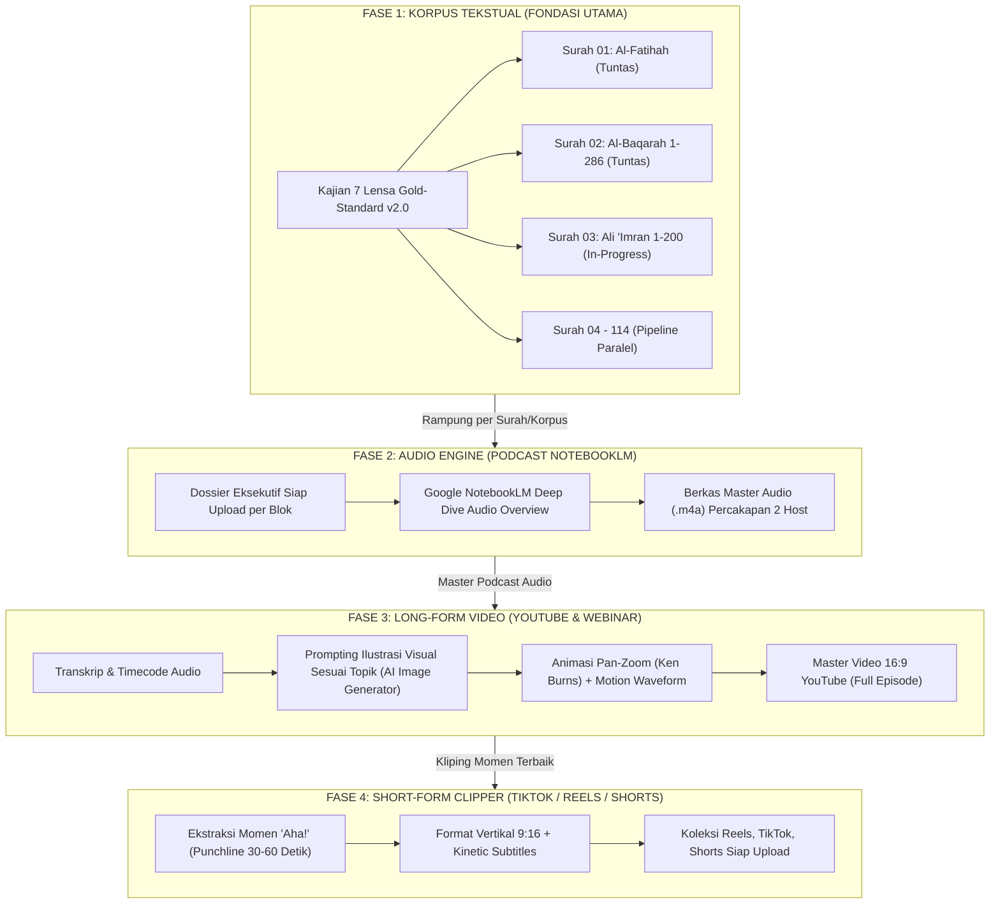

# BLUEPRINT MASTER: PIPELINE MULTIMEDIA END-TO-END
## PROYEK "HIDUP BERSAMA AL-QUR'AN: DARI AYAT, MENJADI CARA BERPIKIR, MENJADI CARA HIDUP"

> **Visi Strategis**: Mengubah riset ensiklopedis 7 Lensa yang mendalam dan berbobot akademis menjadi ekosistem konten digital berdaya jangkau luas (*omnichannel*) melalui 4 tahapan berurutan (*sequential multi-stage pipeline*).

---

---

## 1. FASE 1: Penuntasan Korpus Al-Qur'an (100% Tuntas Paripurna)

*Target: Seluruh 114 Surah (6.236 Ayat) terdokumentasi lengkap dalam format Gold-Standard v2.0 tanpa ada satupun ayat yang terlewat.*

- **Prinsip Utama**: Kualitas konten teks adalah "otak" dan "jiwa" dari seluruh media turunan. Tidak ada kompromi pada kedalaman ilmu:
  - **Lensa 1 & 2**: Akurasi gramatika, tajwid, variasi qira'at, morfologi (*sharaf*), sintaksis (*i'rab*), dan 3 cabang balaghah.
  - **Lensa 3 & 4**: Rekonstruksi sosio-historis (asbabun nuzul sahih), munasabah ayat, dan komparasi mufasir muktabar.
  - **Lensa 5**: Sintesis mental model, kognisi sistemik, dan arsitektur jiwa.
  - **Lensa 6 & 7**: Relevansi krisis kontemporer abad ke-21, 3 mikro-tindakan harian, dan muhasabah qalbiyyah.
- **Milestone Saat Ini**:
  - Surah 01: Al-Fatihah (8 berkas) — **100% Selesai**.
  - Surah 02: Al-Baqarah (287 berkas) — **100% Selesai**.
  - Surah 03: Ali 'Imran (200 ayat) — **Infrastruktur Folder & Dossier Siap, Masuk Antrean Generator**.

---

## 2. FASE 2: Audio Engine (Podcast NotebookLM per Blok)

*Target: Setiap blok tematik surah memiliki 1 episode podcast diskusi mendalam (durasi 15–25 menit) berkualitas tinggi.*

- **Mengapa NotebookLM?**:
  - Menggunakan model audio generatif *end-to-end* Google DeepMind dengan dinamika percakapan 2 host (pria & wanita) paling manusiawi di dunia.
  - Natural micro-banter: jeda napas, reaksi spontan (*"Wah, menarik banget!"*, *"Wait, tapi bukannya..."*), dan intonasi rasa ingin tahu yang genuine.
  - Bebas kuota karakter (unlimited) dan langsung mengekstrak dokumen sumber tebal.
- **Standard Operating Procedure (SOP) Eksekusi**:
  1. Generate *Dossier Eksekutif Siap Upload* per blok dari folder `NotebookLM_Hub/05_Dossiers_Siap_Upload/`.
  2. Unggah ke notebook surah terkait di [notebooklm.google.com](https://notebooklm.google.com/).
  3. Berikan arahan *Customize Audio Overview*:
     > *"Fokuskan diskusi pada tadabbur mendalam, analogi kehidupan modern, paradoks berpikir Iblis vs Adam, dan transformasi cara hidup sehari-hari secara hangat dan menyentuh hati."*
  4. Unduh berkas audio `.m4a` dan arsipkan di folder blok surah dengan nama standar:
     `Podcast_HBQ_[Surah]_[Blok]_[Judul_Topik].m4a`

---

## 3. FASE 3: Visual Engine — Long-Form YouTube & Media Sosial Panjang

*Target: Mengubah audio podcast 15–25 menit menjadi video sinematik berilustrasi horizontal (16:9, 1080p/4K) yang memanjakan mata pendengar.*

- **Elemen Arsitektur Video**:
  1. **Audio Master**: Trek audio podcast dari NotebookLM.
  2. **Ilustrasi Tematik Sesuai Pembicaraan (Visual Storyboard)**:
     - Setiap perubahan topik pembicaraan (tiap 1–2 menit) diiringi pergantian ilustrasi visual berkualitas tinggi yang relevan secara metaforis (misal: ilustrasi partikel tanah liat menyerap air vs kobaran api yang membakar, padang pasir malam hari, kompas jiwa, peradaban modern yang sibuk).
     - Gaya visual konsisten: *Cinematic, Atmospheric Islamic Heritage, Minimalist Concept Art* (tanpa memvisualisasikan wujud fisik malaikat/nabi/Tuhan).
  3. **Motion & Dynamic Feel**:
     - *Ken Burns Effect* (gerakan perlahan zoom-in / pan-out pada gambar statis).
     - Gelombang audio dinamis (*audio waveform visualizer*) yang bergerak sesuai frekuensi suara host.
     - *Subtitles / Closed Captions* dinamis yang sinkron dengan kata-kata yang diucapkan.
- **Platform Distribusi**: YouTube Long-form, Spotify Video Podcast, dan Web Portal Resmi.

---

## 4. FASE 4: Clipper Engine — Short-Form Viral (TikTok / IG Reels / Shorts)

*Target: Memproduksi 5–10 cuplikan video vertikal (9:16, durasi 30–60 detik) dari setiap episode podcast untuk menjangkau jutaan audiens muda.*

- **Kriteria Kurasi Klip ("The Hook & The Aha! Moment")**:
  - **Hook Detik 1-3**: Pernyataan kontraintuitif atau pertanyaan mengejutkan (contoh: *"Tahu nggak kenapa tanah liat bisa mengalahkan cahaya?"* atau *"Shalat kita hampa bukan karena kita malas, tapi karena ini..."*).
  - **Pemberian Wawasan (Detik 4-45)**: Penjelasan inti rahasia ayat dengan bahasa yang membumi.
  - **Punchline & Call to Action (Detik 46-60)**: Nasihat mikro yang bisa langsung dipraktikkan hari ini.
- **Standar Visual Short-Form**:
  - Aspek rasio vertikal 9:16.
  - *Kinetic Word-by-Word Captions* (teks besar di tengah layar dengan highlight kata aktif warna kuning emas/hijau emerald).
  - Ilustrasi visual penuh di latar belakang atau format *split screen* (visual metafora di atas, audio visualizer/avatar di bawah).
- **Platform Distribusi**: TikTok, Instagram Reels, YouTube Shorts, dan Status WhatsApp.

---

## 5. Ringkasan Matriks Alur Kerja

| Fase | Fokus Utama | Input | Tools & Engine | Output Akhir |
| :---: | :--- | :--- | :--- | :--- |
| **1** | **Korpus Tekstual** | Mushaf, Tafsir 6 Ulama, Mu'jam Maqayis | Framework 7 Lensa + Automation PowerShell | 114 Surah Lengkap (HTML v2.0 & Docx) |
| **2** | **Audio Engine** | Berkas Dossier Kajian per Blok | Google NotebookLM Deep Dive | Berkas Audio Podcast Master (.m4a) |
| **3** | **Long-Form Video** | Audio Podcast + Transkrip | AI Image Gen + Video Editor (Remotion/CapCut/Premiere) | Video YouTube 16:9 Sinematik Full Episode |
| **4** | **Short Clipper** | Master Video Long-Form | Clipper Tools (OpusClip/CapCut/Python MoviePy) | 5-10 Klip Vertikal 9:16 (TikTok/Reels/Shorts) |
